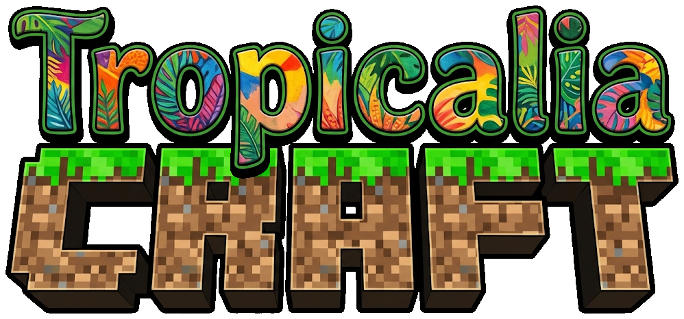

<p align="center">
  
</p>

<p align="center">
  <a href="https://github.com/gusdslara/tropicaliacraft-launcher/releases/latest"></a>
  <a href="https://github.com/gusdslara/tropicaliacraft-launcher/actions/workflows/ci.yml"></a>
  
  
  
  <a href="LICENSE"></a>
</p>

# TropicaliaCraft Launcher

A Minecraft launcher for **Windows, Linux, macOS and Android** that puts two ways of playing in
one app:

- **Rust mode** – runs [Horizon](https://playhorizon.dev), a reimplementation of the Minecraft:
  Java Edition client written in Rust (Vulkan), on desktop, and its Android port
  [Horizon Android](https://github.com/starling-client/starling) on phones.
- **Java mode** – runs the original Minecraft: Java Edition (Vanilla, Fabric, Quilt, Forge,
  NeoForge). On Android it uses a modified [PojavLauncher](https://github.com/PojavLauncherTeam/PojavLauncher)
  runtime with [MojoLauncher](https://github.com/MojoLauncher)'s GLFW, SDL and mojoexec.

It also manages servers (Paper, Purpur, Fabric, hybrid Forge servers and the Rust server
[Pumpkin](https://github.com/Pumpkin-MC/Pumpkin)), mods and modpacks from Modrinth and
CurseForge, skins and touch controls.

> **Not an official Minecraft product.** Not approved by or associated with Mojang or Microsoft.
> No game files are included: Minecraft is downloaded from Mojang's servers with your own
> Microsoft account, which must own Minecraft: Java Edition.

## Download

Get the latest build from **[Releases](https://github.com/gusdslara/tropicaliacraft-launcher/releases/latest)**.

| Platform | File | Notes |
|---|---|---|
| Windows 10/11 x64 | `TropicaliaLauncher_<version>_x64-setup.exe` or `.msi` | Installs WebView2 if missing. |
| Linux x64 | `.AppImage`, `.deb` | The tray icon needs `libayatana-appindicator3`. |
| macOS (Apple Silicon and Intel) | `.dmg` | Not notarized: right-click → **Open** the first time, or run `xattr -dr com.apple.quarantine /Applications/TropicaliaLauncher.app`. |
| Android 9+ arm64 | `TropicaliaLauncher-<version>-android-arm64.apk` | Signed with our release key. If you installed an older debug build, uninstall it once before installing. |

Every release has a `SHA256SUMS.txt`. Check a download with `sha256sum -c SHA256SUMS.txt --ignore-missing`.

iOS is not offered: the Java and Horizon runtimes need to run JIT/native code that iOS does not
allow for sideloaded apps, so an `.ipa` would only show the launcher UI without being able to play.

## Repository layout

| Path | What it is | Upstream |
|---|---|---|
| `tropicalia-launcher/` | The app: Tauri v2 (Rust) + SvelteKit 5 + Tailwind 4. Desktop app and Android shell | ours (MIT) |
| `tools/pojav-android/` | Java runtime for Android: PojavLauncher plus our patches (`com.tropicaliacraft.launcher`, Tauri bridge, RAM notice, loading text) | [PojavLauncherTeam/PojavLauncher](https://github.com/PojavLauncherTeam/PojavLauncher) `v3_openjdk` (LGPL-3.0) |
| `tools/pojav-android/glfw` | GLFW for Android | [MojoLauncher/glfw](https://github.com/MojoLauncher/glfw) (zlib) |
| `tools/pojav-android/mojoexec` | mojoexec, plus our `vulkan_shim` | [MojoLauncher/mojoexec](https://github.com/MojoLauncher/mojoexec) (MIT) |
| `tools/pojav-android/sdl` | SDL for Android | [MojoLauncher/MojoSDL](https://github.com/MojoLauncher/MojoSDL) (zlib) |
| `tools/horizon-android/` | Horizon engine on Android, offline extraction | [Vasysik/horizon-android](https://github.com/starling-client/starling) (MIT) |
| `tools/horizon-desktop/` | Horizon engine on desktop, plus branding | Horizon by Ludovic Marie, `horizon-rust/horizon` (MIT) |
| `tools/*.py`, `tools/horizon-patches/` | Patch and icon scripts used by the build | ours (MIT) |
| `tropicalia-launcher-lab/` | Architecture research and notes | ours (MIT) |

The landing page, backend and admin panel live in
[gusdslara/tropicaliacraft-fe-be](https://github.com/gusdslara/tropicaliacraft-fe-be).

## Building

Requirements: [Bun](https://bun.sh), Rust stable, and the
[Tauri prerequisites](https://v2.tauri.app/start/prerequisites/) for your OS.

```bash
cd tropicalia-launcher
bun install
bun run tauri dev      # desktop app in development mode
bun run dev            # UI only, in the browser (game and server actions are disabled)
bun run tauri build    # Windows .msi/.exe, Linux .deb/.AppImage, macOS .dmg
```

Tests: `cd src-tauri && cargo test` and `bun run check`.

**Android** builds the Tauri library, Horizon Android and the PojavLauncher Gradle project into
one APK. On Linux/macOS, with the Android SDK/NDK, JDK 17 and Rust:

```bash
TROPICALIA_SIGNING_PROPERTIES=/path/to/release.properties \
TROPICALIA_SUPPORT=/path/to/tauri-android-support-jars \
tropicalia-launcher/scripts/build-android-release.sh
```

`release.properties` holds `storeFile`, `storePassword`, `keyAlias` and `keyPassword` of your own
key; the official key is never in this repository. On Windows, `scripts/build-pojav.ps1` builds a
debug APK. See [`tropicalia-launcher/README.md`](tropicalia-launcher/README.md).

**Releases** are built by [`.github/workflows/release.yml`](.github/workflows/release.yml) when a
`v*` tag is pushed: Windows, Linux and macOS on GitHub Actions; the signed Android APK is built
locally (the release key is never stored in the repository) and attached to the same release.

### Pulling upstream changes

Each vendored project is a `git subtree --squash`, so our patches stay in our history and upstream
changes arrive as a merge on top of them:

```bash
scripts/update-upstream.sh pojav          # or horizon-android, horizon, glfw, mojoexec, sdl
scripts/update-upstream.sh all
```

Edit files with LF line endings (`.gitattributes` enforces it) to avoid fake diffs against upstream.

## Credits

This launcher would not exist without these projects. Thank you!

- **[PojavLauncher](https://github.com/PojavLauncherTeam/PojavLauncher)** by the PojavLauncher Team
  and contributors – the Java runtime that makes Minecraft: Java Edition run on Android.
  LGPL-3.0. Itself built on [Boardwalk](https://github.com/zhuowei/Boardwalk) and many libraries
  listed in [its credits](tools/pojav-android/README.md#credits--dependencies).
- **[MojoLauncher](https://github.com/MojoLauncher)** (Maksim Belov and contributors) –
  [glfw](https://github.com/MojoLauncher/glfw) (zlib), [MojoSDL](https://github.com/MojoLauncher/MojoSDL)
  (zlib), [mojoexec](https://github.com/MojoLauncher/mojoexec) (MIT) and the
  [OpenJDK Android builds](https://github.com/MojoLauncher/android-openjdk-build-multiarch).
- **[Horizon](https://playhorizon.dev)** by Ludovic Marie and the Horizon contributors – the
  Minecraft: Java Edition client rewritten in Rust. MIT.
- **[Vasysik](https://github.com/Vasysik)** – [Horizon Android](https://github.com/starling-client/starling),
  the Android port of Horizon (now continued as Starling). MIT.
- **[Pumpkin](https://github.com/Pumpkin-MC/Pumpkin)** by the Pumpkin-MC contributors – the Rust
  Minecraft server, shipped as the unmodified official binary. GPL-3.0.
- **[Tauri](https://tauri.app)**, **[Svelte](https://svelte.dev)**, **[Lucide](https://lucide.dev)**,
  **[Pixelarticons](https://github.com/halfmage/pixelarticons)** and **[three.js](https://threejs.org)**.

Full list, authors and license texts: [`THIRD_PARTY_NOTICES.md`](THIRD_PARTY_NOTICES.md). The
same credits are in the app under **Ajustes → Créditos e licenças**.

## License

- Our code (`tropicalia-launcher/`, scripts, patches): [MIT](LICENSE).
- `tools/pojav-android/`: [LGPL-3.0](tools/pojav-android/LICENSE). Our changes to it are LGPL-3.0
  too. Each release links to the exact source of the runtime it ships, so you can rebuild it or
  replace it with your own.
- `tools/horizon-desktop/`, `tools/horizon-android/`, `mojoexec`: MIT. `glfw`, `sdl`: zlib.

Minecraft is a trademark of Mojang Synergies AB. This project is not affiliated with, endorsed by
or associated with Mojang or Microsoft.

---

## Português (BR)

Launcher de Minecraft do **TropicaliaCraft** para **Windows, Linux, macOS e Android**, com dois
modos de jogo num app só:

- **Modo Rust**: roda o [Horizon](https://playhorizon.dev), o cliente do Minecraft: Java Edition
  reescrito em Rust (Vulkan), no PC, e o port [Horizon Android](https://github.com/starling-client/starling)
  no celular.
- **Modo Java**: roda o Minecraft: Java Edition original (Vanilla, Fabric, Quilt, Forge, NeoForge).
  No Android usa uma versão modificada do runtime do [PojavLauncher](https://github.com/PojavLauncherTeam/PojavLauncher),
  com GLFW, SDL e mojoexec do [MojoLauncher](https://github.com/MojoLauncher).

Também gerencia servidores (Paper, Purpur, Fabric, híbridos e o servidor em Rust Pumpkin), mods e
modpacks do Modrinth e CurseForge, skins e controles de toque.

**Baixar:** veja a página de [Releases](https://github.com/gusdslara/tropicaliacraft-launcher/releases/latest).
Quem tinha a versão de testes (debug) no Android precisa desinstalá-la uma vez antes de instalar a
nova, que é assinada com outra chave.

**Créditos:** PojavLauncher Team (LGPL-3.0), MojoLauncher (zlib/MIT), Horizon de Ludovic Marie e
colaboradores (MIT), Vasysik pelo Horizon Android (MIT) e Pumpkin (GPL-3.0). Lista completa em
[`THIRD_PARTY_NOTICES.md`](THIRD_PARTY_NOTICES.md) e no app, em **Ajustes → Créditos e licenças**.

**Aviso:** não é um produto oficial do Minecraft, nem aprovado ou associado à Mojang ou à
Microsoft. O launcher não inclui arquivos do jogo; é preciso ter o Minecraft: Java Edition na sua
conta Microsoft.

Para compilar, veja [Building](#building) acima e o [`tropicalia-launcher/README.md`](tropicalia-launcher/README.md)
(em português).
