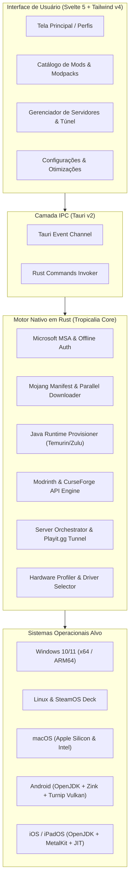
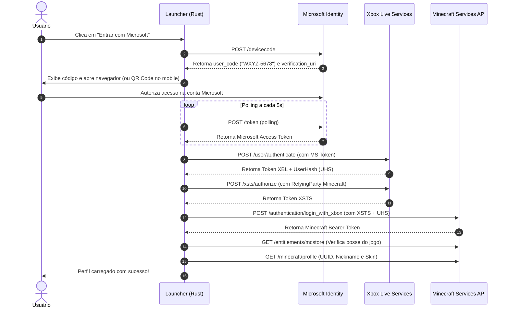
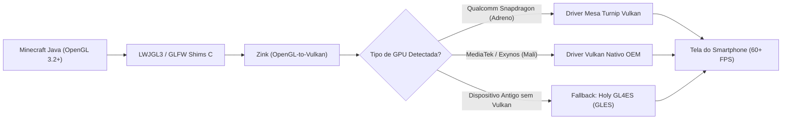
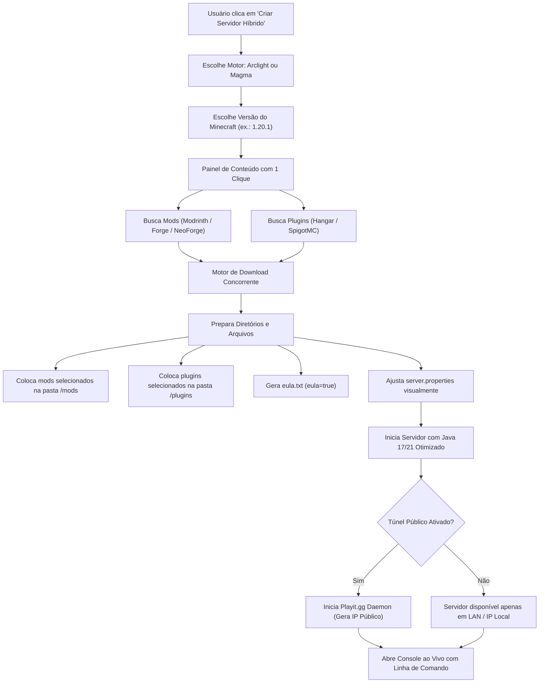

# 📊 Diagramas de Arquitetura e Fluxo do Launcher

Este documento contém os diagramas de engenharia e fluxo operacional do **Tropicalia Universal Launcher**.

---

## 1. Arquitetura Global do Sistema (Core & Multiplataforma)

---

## 2. Fluxo de Autenticação Microsoft (Device Code Flow)

---

## 3. Pipeline Gráfico Mobile (Android Adreno vs Mali)

---

## 4. Fluxo de Criação de Servidor Híbrido (Mods + Plugins)

